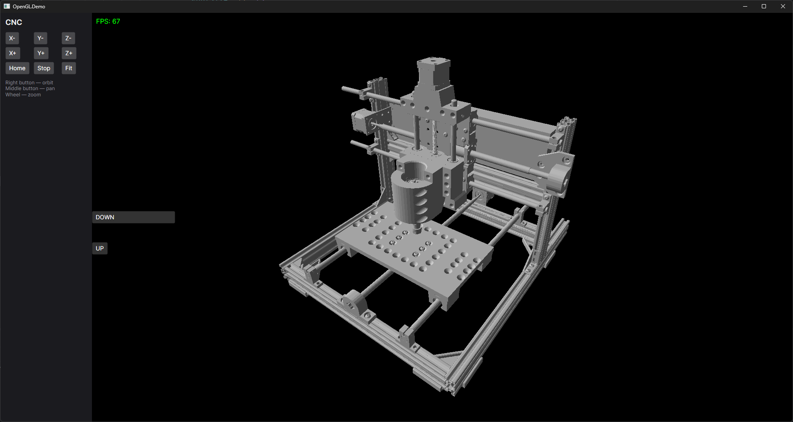

# Avalonia.OpenGLBackend

A custom OpenGL renderer for Avalonia. The main control is `SceneRenderer` (an `OpenGlControlBase`): it draws a scene of objects with OpenGL 3.3 core right inside an Avalonia window. The renderer lives in a separate library (`Avalonia.OpenGLBackend`), and `OpenGL.Demo` shows it in action — a CNC-style control panel next to a 3D view of an STL model.



## Features

- OpenGL 3.3 core rendering inside Avalonia
- Scene of objects with an orbit camera (orbit / pan / zoom) and a configurable background color (fully transparent by default)
- Meshes: `LineMesh` (lines) and `TriangleMesh` (triangles, solid or wireframe-only)
- Built-in objects: `GameObject` (any mesh, per-vertex normal shading), `LineObject`, `GridObject`, `GridObjectBySpacing`
- Model loading through Assimp (`ModelLoader.Load`): STL, OBJ, PLY, FBX, glTF, DAE and other Assimp formats
- Thread-safe scene updates from the UI thread via `EnqueueGlAction`
- Extensible: custom shaders (`VertexShaderSource` / `FragmentShaderSource`), custom `OnGlInit` / `OnUpdate` logic, `IsAnimated` flag

## Requirements

- **Windows only** — WGL is the single platform supported and verified at the moment
- .NET 10 SDK
- GPU with OpenGL 3.3 core support

## Build and run

```powershell
dotnet build Avalonia.OpenGLBackend.sln
dotnet run --project OpenGL.Demo
```

The demo loads the file set by the constant in `OpenGL.Demo/MainWindow.axaml.cs`:

```csharp
private const string ModelPath = @"F:\KompacProjects\CNC_v1\Сборка.stl";
```

Loading runs in the background (`Task.Run`): the window shows `Loading...` while it works and an error message if it fails.

## Demo controls

- Right mouse button — orbit
- Middle mouse button — pan
- Wheel — zoom
- Left panel buttons are decorative: the demo contains no interaction logic
- FPS counter in the top-left corner of the 3D view

## Project structure

```
Avalonia.OpenGLBackend/            library
├── Core/                          scene, objects, camera, transform
│   ├── Scene.cs                   object list + background color
│   ├── SceneObject.cs             base object (mesh, shaders, GL lifetime)
│   ├── Transform.cs               position / rotation / scale, cached model matrix
│   ├── Camera.cs                  orbit camera
│   └── Objects/                   GameObject, LineObject, GridObject*
├── Rendering/
│   ├── SceneRenderer.cs           Avalonia control with the OpenGL context
│   ├── ShaderProgram.cs           shader compilation and linking
│   ├── Mesh.cs                    base mesh (VAO/VBO/EBO)
│   └── Meshes/                    LineMesh, TriangleMesh
├── Formats/ModelLoader.cs         RawMeshData + Assimp loading
└── Extensions/                    UsePlatformRenderBackend()
OpenGL.Demo/                       sample application (Avalonia)
└── MainWindow.axaml(.cs)          control panel + SceneRenderer
```

## Getting started

```csharp
// inside an async method
var renderer = new SceneRenderer
{
    VSyncEnabled = true,          // default
    ContinuousRendering = false   // default: frames are drawn on changes only
};

renderer.Scene.BackgroundColor = Vector4.Zero; // transparent (default)

var raw = await Task.Run(() => ModelLoader.Load("model.stl"));

renderer.EnqueueGlAction(() =>
{
    renderer.Scene.Add(new GameObject
    {
        Name = "Part",
        Color = new Vector3(0.8f, 0.8f, 0.8f),
        MeshFactory = () => TriangleMesh.FromRawData(raw)
    });
});
```

A grid and a line:

```csharp
renderer.EnqueueGlAction(() =>
{
    renderer.Scene.Add(new GridObject(
        Vector3.Zero, Vector3.UnitX, Vector3.UnitZ,
        linesX: 101, linesY: 101, spacingX: 0.1f, spacingY: 0.1f,
        color: new Vector3(0.35f, 0.35f, 0.4f)));

    renderer.Scene.Add(new LineObject(
        new Vector3(-1, 0, 0), new Vector3(1, 0, 0),
        new Vector3(1f, 0.3f, 0.3f)));
});
```

The same `TriangleMesh` renders solid by default; pass `wireframe: true` (or set `Wireframe` at runtime) to draw only triangle edges:

```csharp
MeshFactory = () => TriangleMesh.FromRawData(raw)                  // solid
MeshFactory = () => TriangleMesh.FromRawData(raw, wireframe: true) // edges only
```

Toggling it later is just as simple — `SetObjectWireframe` looks the object up by name and switches its mesh to the edge-only mode:

```csharp
renderer.SetObjectWireframe("Part", true);  // edges only
renderer.SetObjectWireframe("Part", false); // solid again
```

If you keep a reference to the mesh, you can also flip the flag directly inside a GL action:

```csharp
renderer.EnqueueGlAction(() => viewModelMesh.Wireframe = true);
```

## Color

Each object has a `Color`, and every mesh has an optional `Color` that overrides the object one when set. Both are plain `Vector3` values, so any mesh (solid or wireframe) can be recolored — at creation or at runtime:

```csharp
MeshFactory = () =>
{
    var mesh = TriangleMesh.FromRawData(raw, wireframe: true);
    mesh.Color = new Vector3(1f, 0.5f, 0.2f);
    return mesh;
}
```

```csharp
renderer.EnqueueGlAction(() =>
{
    var mesh = renderer.Scene.Objects.First(o => o.Name == "Part").Mesh;
    if (mesh is not null) mesh.Color = new Vector3(0.3f, 0.7f, 1f);
});
```

## Animating objects and lines

**1. Built-in velocities.** `AngularVelocity` is in degrees per second, `LinearVelocity` in world units per second. Any object with a non-zero velocity reports `IsAnimated == true`, so the renderer keeps drawing frames even while `ContinuousRendering` is off.

```csharp
renderer.EnqueueGlAction(() =>
{
    var model = new GameObject
    {
        Name = "Part",
        MeshFactory = () => TriangleMesh.FromRawData(raw)
    };
    model.AngularVelocity = new Vector3(0f, 45f, 0f);
    model.LinearVelocity = new Vector3(0f, 0.5f, 0f);
    renderer.Scene.Add(model);

    var line = new LineObject(Vector3.Zero, Vector3.UnitX * 2f, new Vector3(1f, 0.4f, 0.4f));
    line.Name = "Axis";
    line.AngularVelocity = new Vector3(0f, 0f, 90f);
    renderer.Scene.Add(line);
});
```

**2. Per-frame animation.** Derive from `SceneObject`, update the transform in `OnUpdate(dt)` and return `true` from `IsAnimated` so frames keep coming.

```csharp
public sealed class BobbingPart : SceneObject
{
    private float _time;

    public BobbingPart(RawMeshData data)
    {
        Color = new Vector3(0.8f, 0.8f, 0.8f);
        MeshFactory = () => TriangleMesh.FromRawData(data);
    }

    public override bool IsAnimated => true;

    protected override void OnUpdate(float dt)
    {
        _time += dt;
        Transform.SetPosition(0f, MathF.Sin(_time * 2f) * 0.5f, 0f);
        Transform.SetRotationDegrees(0f, _time * 45f, 0f);
    }
}
```

```csharp
renderer.EnqueueGlAction(() => renderer.Scene.Add(new BobbingPart(raw)));
```

**3. Moving things from the UI thread.** Scene state may only be touched on the GL thread, so either use the by-name helpers or wrap the change in `EnqueueGlAction`.

```csharp
renderer.SetObjectPosition("Part", new Vector3(1f, 0f, 0f));
renderer.SetObjectRotationDegrees("Axis", new Vector3(0f, 90f, 0f));

renderer.EnqueueGlAction(() =>
{
    var line = renderer.Scene.Objects.First(o => o.Name == "Axis");
    line.Transform.SetPosition(-1f, 0f, 0f);
    line.Transform.Rotate(new Vector3(0f, 15f, 0f)); // Rotate() adds degrees
});
```

Same calls inside a button handler or a `DispatcherTimer` tick give you interactive movement of models and lines.

## Limitations

- Meshes are triangles and lines only; textures and materials are not supported — one color per object (optionally overridden per mesh) with normal-based shading (single light, no shadows)
- STEP/IGES are not supported: Assimp reads tessellated formats, while B-rep needs a CAD kernel (OpenCascade, for example)
- Only Windows (WGL) works for now; Linux/macOS branches are not verified
- The OpenGL context is provided by Avalonia; no custom context or multi-window rendering
- The transparent background depends on the Avalonia compositor honoring surface alpha (in the demo the window / parent `Border` provides the backdrop)
